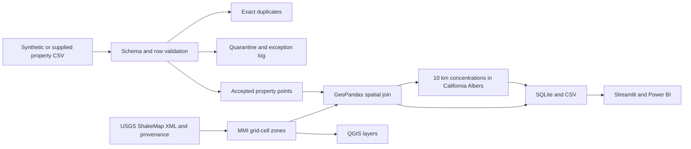

# Property Exposure Analytics & Geospatial Risk Assessment

**[Open the live Streamlit dashboard](https://sanchay-property-exposure-atlas.streamlit.app/)** — explore exposure charts, geographic maps, concentration tables and data-quality results directly in your browser. No installation or sign-in required.

**[View the Working Model — charts, map and validation results](Working%20Model.md)**


A runnable portfolio project joining **synthetic California property exposures** to the **public USGS ShakeMap for the 2019 Ridgecrest M7.1 earthquake**. Includes data profiling, quarantine and duplicate controls, spatial joins, accumulation analysis, SQLite views, an interactive dashboard, Power BI project, and GIS layers for QGIS.

## Run

Python 3.10 or later, from this folder:

```powershell
python -m pip install -r requirements.txt
python pipeline.py
python build_powerbi.py
python -m pytest -q
python -m streamlit run app.py
```

The first run downloads the pinned USGS grid. The included snapshot makes subsequent runs work offline. Map tiles and Leaflet assets require internet. `python pipeline.py --refresh` explicitly refreshes the source. Use `--properties path/to/properties.csv` for your own portfolio; this does not overwrite the synthetic input. Both modes overwrite analytical outputs. Required columns are listed in `docs/methodology.md`.

## Deliverables

| Artifact | Purpose |
|---|---|
| `app.py` | Filterable exposure dashboard, map, concentration table and exception register |
| `outputs/exposure_map.html` | Standalone interactive map with hazard zones and properties |
| `outputs/exposure.sqlite` | Typed property, quarantine, exception and accumulation tables, plus analytical SQL views |
| `outputs/properties.csv` | Accepted, geocoded, hazard-enriched portfolio |
| `outputs/hazard_zones.geojson` | Derived MMI V, VI and VII+ cell polygons, EPSG:4326 |
| `outputs/concentration.gpkg` | 10 km accumulation cells, EPSG:3310 |
| `outputs/validation.json` | Row reconciliation, rule counts, value totals and source hash |
| `outputs/findings.md` | Generated findings and improvement recommendations |
| `powerbi/Property_Exposure.pbip` | Native Power BI import model and three report pages |
| `docs/methodology.md` | Assumptions, field dictionary, limitations and source provenance |
| `docs/gis-and-powerbi.md` | QGIS and Power BI operating instructions |

## Interpretation

The historical scenario measures the total insured value located in shaking-intensity bands. **It does not estimate losses or annual earthquake risk.** Property locations, attributes and values are synthetic. California scope validation is a bounding-box screen, not a legal state-boundary test. The example illustrates controls and analytical methods; do not present it as a real insurer's portfolio or a production catastrophe model.

Power BI files are generated source artifacts. Desktop opening and rendering must be checked in your installed Power BI version before publishing. The Streamlit dashboard is independently runnable.

## Architecture



Source: [USGS earthquake event](https://earthquake.usgs.gov/earthquakes/eventpage/ci38457511/executive), [pinned ShakeMap grid](https://earthquake.usgs.gov/product/shakemap/ci38457511/atlas/1594160054783/download/grid.xml), [ShakeMap product documentation](https://ghsc.code-pages.usgs.gov/esi/shakemap/docs2020/manual4_0/ug_products.html).
