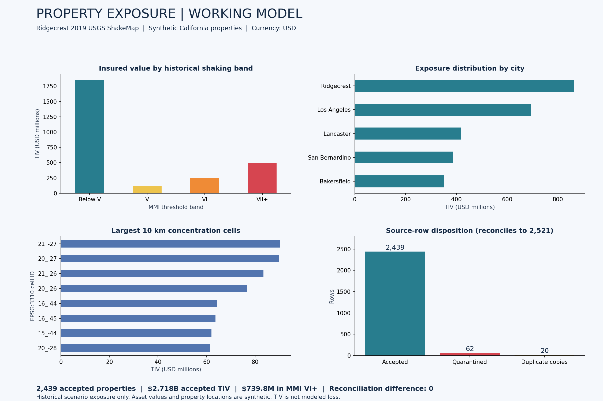
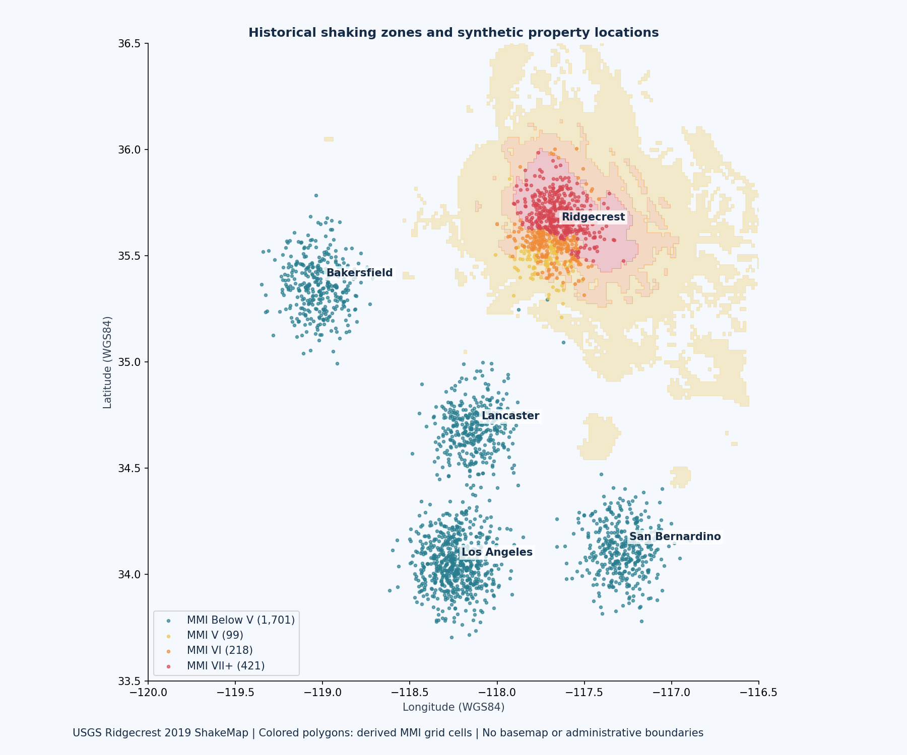

# Working Model — Property Exposure Analytics

## Open the live website

**[Launch the interactive Property Exposure Atlas](https://sanchay-property-exposure-atlas.streamlit.app/)**

Explore the dashboard directly in your browser, including city and occupancy filters, property locations, historical hazard overlays, geographic concentrations and data-quality exceptions. No installation or sign-in required. The property portfolio is synthetic; hazard data comes from the USGS historical Ridgecrest ShakeMap. If the hosting service has put the app to sleep, allow it to wake up.

This page shows the results of an executed Python and GeoPandas pipeline. Review the charts directly here, then explore the code, source data and validation outputs. Property records are **synthetic**; shaking data comes from **USGS's historical 2019 Ridgecrest earthquake ShakeMap**.

| Accepted properties | Total insured value | TIV in historical MMI VI+ | Row reconciliation |
|---:|---:|---:|---:|
| 2,439 | $2.718 billion | $739.8 million | 0 difference |

## Exposure, concentrations and data quality



## Geographic exposure



MMI bands use continuous grid thresholds: V = 5 to below 6, VI = 6 to below 7, VII+ = 7 and above. Below V applies only within ShakeMap coverage. TIV is the asset value in a zone, **not an estimate of loss or annual earthquake risk**.

## Run the interactive dashboard

```bash
git clone https://github.com/Sanchay20Shukla/property-exposure-analytics.git
cd property-exposure-analytics
python -m pip install -r requirements.txt
python -m streamlit run app.py
```

The repository includes generated outputs and a cached hazard snapshot, so the dashboard can open without rerunning the pipeline. The dashboard supports city and occupancy filters, an interactive property map, hazard overlays, concentration tables, CSV downloads and a data-quality exception register. Map tiles require internet access. Run it locally using the commands above, or use the public app linked at the top.

For the full Leaflet map, download the repository and open [`outputs/exposure_map.html`](outputs/exposure_map.html) in a browser. GitHub's file viewer shows HTML source rather than running the map.

## Technical review

- [Pipeline source](pipeline.py): deterministic property generation, source retrieval, validation, spatial joins and output generation.
- [Validation results](outputs/validation.json): 2,521 raw rows = 2,439 accepted + 62 quarantined + 20 duplicate copies.
- [Findings and recommendations](outputs/findings.md).
- [Automated tests](tests/test_pipeline.py): validation edge cases, conflicting IDs, shared spatial boundaries, out-of-coverage behavior and reconciled outputs.
- [SQL analytical views](sql/views.sql).
- [Power BI project](powerbi/Property_Exposure.pbip) and [Power BI / QGIS instructions](docs/gis-and-powerbi.md). Power BI Desktop rendering requires local verification.
- [Methodology and limitations](docs/methodology.md).

Validated during development: **11 automated tests passed**, plus Streamlit runtime checks for full, filtered and empty selections. Reproduce using `python -m pytest -q` after installing dependencies.

To refresh all analysis and chart previews:

```bash
python pipeline.py
python build_powerbi.py
python -m pip install matplotlib
python build_preview.py
```
